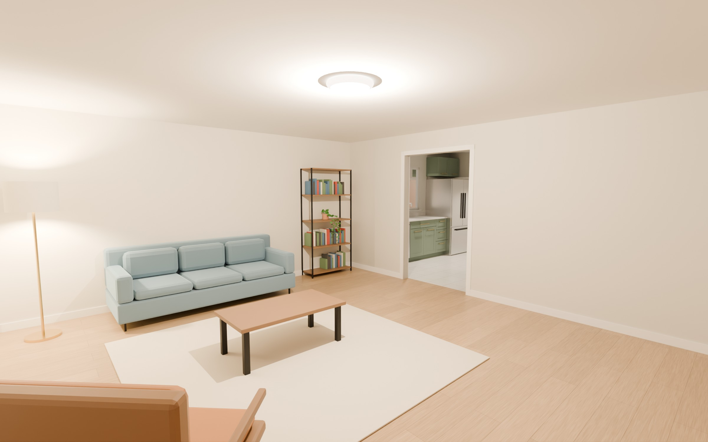
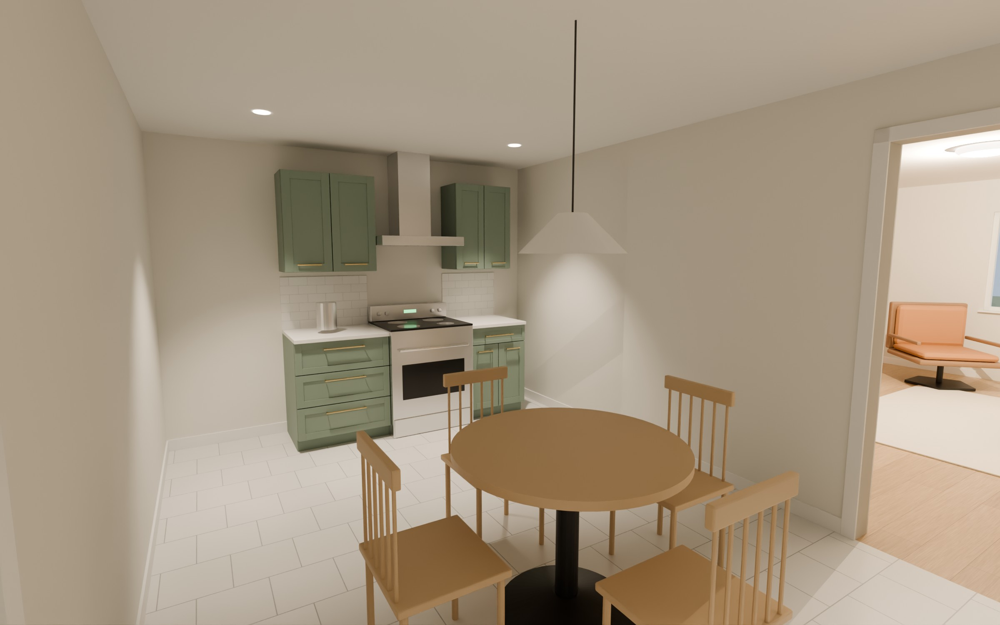
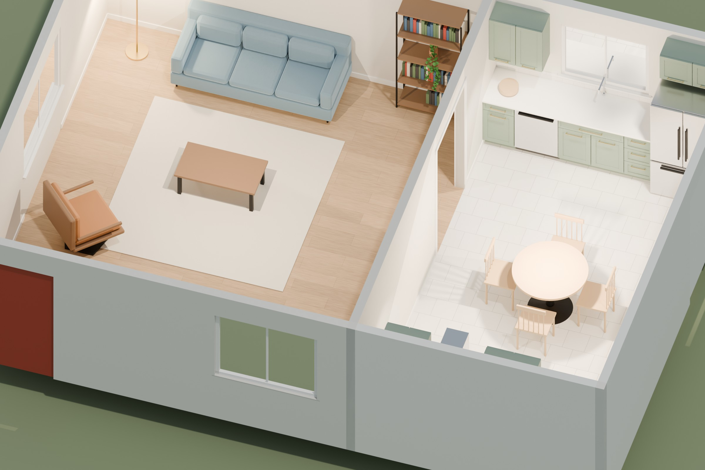

# scan-to-blender

A Claude Code plugin that turns an iPhone room scan (RoomPlan / Polycam `.usdz`) and a few
walkthrough videos of a home into:

1. a clean **floorplan** and cutaway, for you to approve,
2. **room models** matched to the video, at the detail level you pick,
3. **lit renders** of each room and the whole level.

Claude drives Blender for you: headless for builds and renders, and optionally your live Blender
window over MCP so you can orbit the model as it's built.

| Floorplan | Living room | Kitchen | Whole level |
|---|---|---|---|
|  |  |  |  |

*Renders of the bundled example: a made-up two-room cottage (`reference/example_*.py`).*

## Install

As a plugin (recommended):

```
/plugin marketplace add Matthew-Myers/scan-to-blender
/plugin install scan-to-blender@scan-to-blender
```

Without the plugin system, copy `skills/scan-to-blender` and `skills/blender-mcp-setup` into
`~/.claude/skills/`. Register the MCP server yourself if you want live Blender (see
`skills/blender-mcp-setup/reference/server-registration.md`).

### Requirements

- [Blender](https://www.blender.org/download/) 4.2 or newer (developed on 5.2). All scripts run
  inside Blender's own Python, so you don't need system Python, PIL or ffmpeg.
- A GPU is optional. Cycles uses OptiX, CUDA, HIP, Metal or oneAPI if it finds one, and
  otherwise the CPU (`RENDER_DEVICE=CPU` forces the CPU).
- For live Blender only: [uv](https://docs.astral.sh/uv/) and the
  [mcp-for-blender](https://github.com/ahujasid/mcp-for-blender) add-on. The `blender-mcp-setup`
  skill walks you through it. It isn't bundled here: install it from its own repo.

## Use

Make a folder for one level of the home, put the scan in `source/scan/` and the videos in
`source/video/`, then ask Claude something like:

> Here's a scan and three videos of my basement. Make me a floorplan and model the rooms.

The skill works in phases and stops for your OK at each gate:

| Phase | What happens | You decide |
|---|---|---|
| 0 | Connect to live Blender, or fall back to headless | |
| 1 | Read the scan; pull stills from each video; work out which room is which | Confirm the footprint |
| 2 | Floorplan and cutaway renders | **"Does the floorplan look right?"** |
| 3 | Detail level and a short list of items per room | Pick a preset; add or remove items |
| 4 | | Room by room, or all rooms in parallel |
| 5 | Model each room; compare each video still with its render | Approve or correct each room |
| 6 | Test pass, then high-resolution renders lit by the room's real fixtures | |

**Detail presets:**

- **bare**: shell only.
- **shelves cleared**: furniture and shelving, all empty.
- **decluttered** (default): plus what belongs on the furniture and shelves, with no mess.
- **as-is**: everything, simplified.

The aim is a model you recognise, not a perfect one: small things are simplified on purpose.

## What's inside

```
skills/scan-to-blender/
  SKILL.md                    the workflow
  reference/lessons.md        the principles (detail presets, asking, plausibility, ...)
  reference/gotchas.md        technical facts: USDZ import, video, platforms, Blender
  reference/materials.md      texture recipes (Poly Haven, CC0)
  reference/room-agent-brief.md   prompt template for parallel room agents
  reference/example_*.py      the demo cottage: level + two rooms
  scripts/roomkit.py          building blocks: walls, cabinets, appliances, furniture, lights, cameras
  scripts/*.py                scan inspection, frame extraction, contact sheets, comparisons, assembly
skills/blender-mcp-setup/     get Claude driving your live Blender window, and prove it
.mcp.json                     declares the blender MCP server (uvx mcp-for-blender, telemetry off)
```

Textures and HDRIs come from [Poly Haven](https://polyhaven.com) (CC0). They are downloaded when
needed and not included here.

## Privacy

Your scan, videos, stills and renders stay in your project folder. Nothing is uploaded except
Poly Haven downloads, and 3D generation if you enable it in the Blender add-on (off by default).
The `.gitignore` keeps scans, videos and renders out of git, so a home layout doesn't get
committed by accident.

## License

MIT. See [LICENSE](LICENSE).
