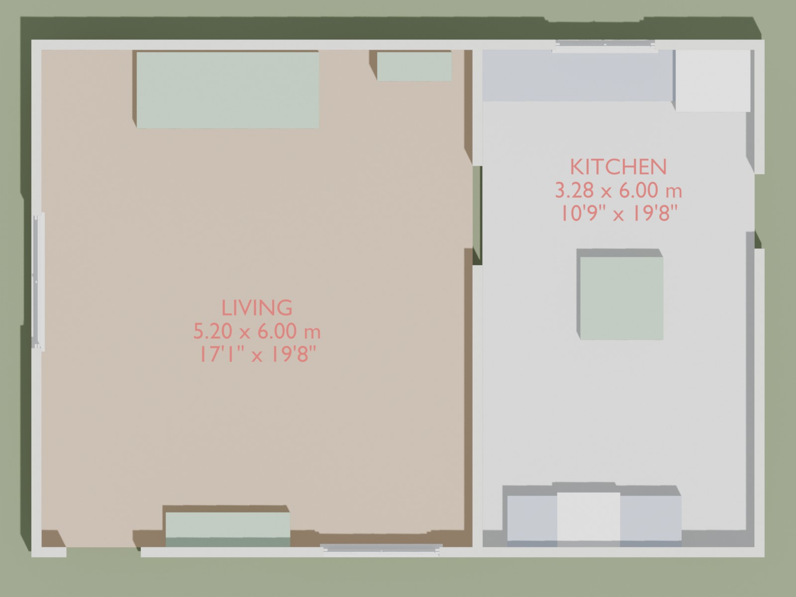

# scan-to-blender

A suite of Claude Code skills for scanning a home and rebuilding it in Blender. An iPhone room
scan (RoomPlan / Polycam `.usdz`) and a few walkthrough videos become:

1. a clean **floorplan** and cutaway, for you to approve,
2. **room models** matched to the video, at the detail level you pick,
3. **lit renders** of each room and the whole level.

Renovation design, contractor drawings and product fitting are next (see the roadmap below).

Claude drives Blender for you: headless for builds and renders, and optionally your live Blender
window over MCP so you can orbit the model as it's built.

| Floorplan | Living room | Kitchen | Whole level |
|---|---|---|---|
|  |  |  |  |

*Renders of the bundled example: a made-up two-room cottage.*

## The skills

| Skill | What it does |
|---|---|
| **home-project** | Starts or resumes a project, keeps `project.json` (geometry + progress), says what's next. Holds the shared toolkit and principles. |
| **scan-capture** | Before you start: how to scan and film each room so nothing needs re-shooting. |
| **scan-to-floorplan** | Scan + videos → room outlines, doors and windows, floorplan and cutaway renders, approved by you. |
| **room-rebuild** | Approved floorplan → each room modelled at your detail level, compared still-by-still with the video → final lit renders. |
| **blender-mcp-setup** | Optional: connects Claude to your open Blender window, and proves it. |

Each skill ends at a point where you approve the result. `project.json` records where every
room is up to, so you can stop and pick up again in a later session. Ask "where are we on the
basement?" and the home-project skill reports and names the next step.

## Install

As a plugin (recommended):

```
/plugin marketplace add Matthew-Myers/scan-to-blender
/plugin install scan-to-blender@scan-to-blender
```

Without the plugin system, copy every folder in `skills/` into `~/.claude/skills/`. They find
each other as siblings. Register the MCP server yourself if you want live Blender (see
`skills/blender-mcp-setup/reference/server-registration.md`).

### Requirements

- [Blender](https://www.blender.org/download/) 4.2 or newer (developed on 5.2). All scripts run
  inside Blender's own Python, so you don't need system Python, PIL or ffmpeg.
- A GPU is optional. Cycles uses OptiX, CUDA, HIP, Metal or oneAPI if it finds one, and
  otherwise the CPU (`RENDER_DEVICE=CPU` forces the CPU).
- For live Blender only: [uv](https://docs.astral.sh/uv/) and the
  [mcp-for-blender](https://github.com/ahujasid/mcp-for-blender) add-on. The `blender-mcp-setup`
  skill walks you through it. It isn't bundled here: install it from its own repo.

## Use

Ask Claude something like:

> Here's a scan and three videos of my basement. Make me a floorplan and model the rooms.

Claude sets up a project folder (`source/`, `frames/`, `scripts/`, `renders/`, `project.json`) and
works through the stages:

| Stage | What happens | You decide |
|---|---|---|
| Floorplan | Reads the scan, pulls stills from each video, builds walls, doors and windows | Confirm the footprint; **"Does the floorplan look right?"** |
| Items | A short list of the main items per room | Pick a detail preset; add or remove items |
| Rooms | Models each room; puts each video still beside its render | Room by room or in parallel; approve or correct each room |
| Finals | Test pass, then high-resolution renders lit by the room's real fixtures | |

**Detail presets:**

- **bare**: shell only.
- **shelves cleared**: furniture and shelving, all empty.
- **decluttered** (default): plus what belongs on the furniture and shelves, with no mess.
- **as-is**: everything, simplified.

The aim is a model you recognise, not a perfect one: small things are simplified on purpose.

## What's inside

```
skills/home-project/          project.json + shared toolkit
  scripts/project.py          init / sync / status, and pj.geometry(room) for every script
  scripts/roomkit.py          building blocks: walls, cabinets, appliances, furniture, lights, cameras
  scripts/*.py                frames from video, contact sheets, still-vs-render, Poly Haven downloads
  reference/lessons.md        the principles every stage follows
  reference/project-format.md the project file, field by field (+ example-project.json)
skills/scan-capture/          scanning and filming checklist
skills/scan-to-floorplan/     scan inspection and survey scripts, example level
skills/room-rebuild/          whole-level assembly, example rooms, materials, parallel-agent brief
skills/blender-mcp-setup/     live Blender connection
.mcp.json                     declares the blender MCP server (uvx mcp-for-blender, telemetry off)
```

Textures and HDRIs come from [Poly Haven](https://polyhaven.com) (CC0). They are downloaded when
needed and not included here.

## Roadmap

- **0.3: renovation-concepts.** A design brief, then 2–3 options per room as changes to the room
  as it is today. Before/after renders from the same camera.
- **0.4: renovation-docs.** Dimensioned plans and wall views, cabinet layouts, and quantities
  (paint, flooring, tile, trim) for a contractor or the hardware store.
- **0.5: product-fit.** Drop in real products from a link or measurements, check clearances, keep a
  priced shopping list.

## Privacy

Your scan, videos, stills and renders stay in your project folder. Nothing is uploaded except
Poly Haven downloads, and 3D generation if you enable it in the Blender add-on (off by default).
The `.gitignore` keeps scans, videos and renders out of git, so a home layout doesn't get
committed by accident.

## License

MIT. See [LICENSE](LICENSE).
